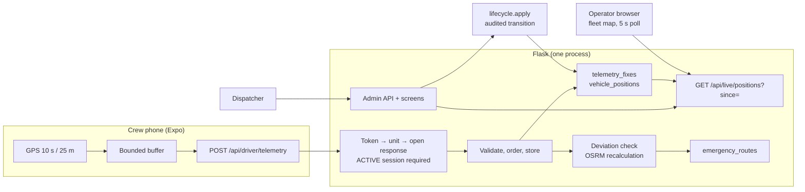
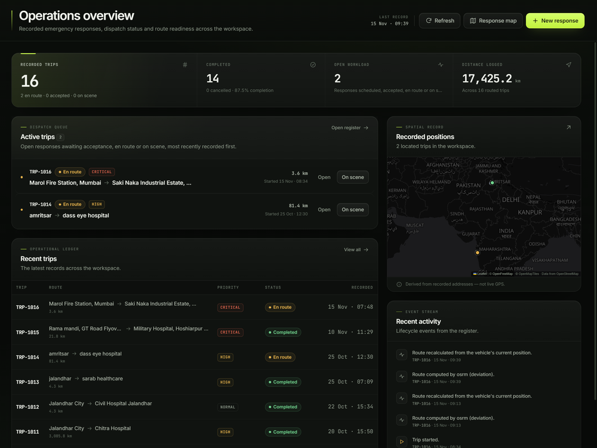
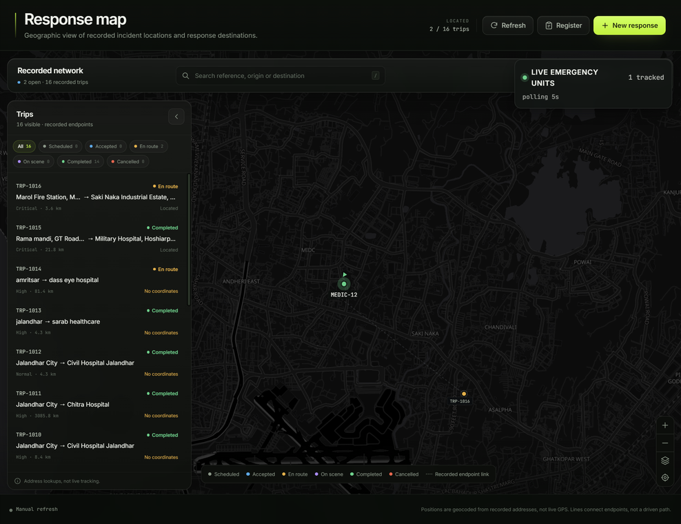

# GREEN ROUTE

An emergency response coordination platform in one repository: a Flask backend that
serves both the dispatcher's web console and the driver API, and an Expo application on
the crew's phone.

A dispatcher records an emergency response, assigns a unit, and watches that unit move
on a map. The crew's phone shows the assignment with the road route, moves the response
through its lifecycle, and reports GPS while it is en route. Routing happens on the
server through OSRM; positions are validated, stored and turned into a telemetry health
state that the operations map displays.

This is a development project. It is not connected to any emergency service, it is not
deployed, and it makes no claim about response times.

---

## Contents

- [What it solves](#what-it-solves)
- [How it works](#how-it-works)
- [Components](#components)
- [Screenshots](#screenshots)
- [What is implemented](#what-is-implemented)
- [What is not implemented](#what-is-not-implemented)
- [Technology](#technology)
- [Repository layout](#repository-layout)
- [Prerequisites](#prerequisites)
- [Backend setup](#backend-setup)
- [Driver app setup](#driver-app-setup)
- [Configuration](#configuration)
- [Database](#database)
- [Running the backend](#running-the-backend)
- [Running the driver app](#running-the-driver-app)
- [Connecting a phone to the local backend](#connecting-a-phone-to-the-local-backend)
- [API overview](#api-overview)
- [Tests](#tests)
- [Troubleshooting](#troubleshooting)
- [Security and privacy](#security-and-privacy)
- [Project status](#project-status)
- [Roadmap](#roadmap)
- [Documentation](#documentation)
- [Contributing](#contributing)
- [Licence](#licence)

---

## What it solves

A dispatch desk needs three things that a spreadsheet and a phone call cannot give it:
one authoritative state for each response, a record of who changed that state and when,
and a defensible answer to "where is the vehicle now". GREEN ROUTE puts those three in
one place:

- **One lifecycle, enforced on the server.** A response moves through a fixed set of
  states; every move is checked against the current state and the actor's role, and is
  written with its event, its transition row and its actor in a single transaction.
- **One route record.** Geometry comes from OSRM, is cached, and every recomputation is
  kept with the previous one marked superseded, so the path at a past moment is still
  answerable.
- **One position per response, with an honest freshness label.** Positions are
  validated, ordered and stored; the operator sees LIVE, DELAYED, STALE or LOST rather
  than an unqualified dot on a map.

## How it works



A position travels: phone → authenticated ingest → validation → trail row plus latest
position → health state → admin overlay. A status travels: operator or crew → one
lifecycle function → conditional `UPDATE` → event, transition row, session projection,
audit entry, one transaction.

`docs/architecture.md` has the detailed version, including why polling was chosen over
WebSockets and where SQLite stops being enough.

## Components

| Component | What it is |
|---|---|
| Backend (`backend/`) | Flask 3, Jinja templates, vanilla JavaScript, no build step. Serves the console, the driver API and all persistence |
| Admin console | The pages inside the backend: dispatch queue, response register, response map, resources, analytics, audit log, administrator management |
| Driver API | Bearer-token JSON API (around 15 endpoints) used only by the crew app |
| Crew phone app (`driver-app/`) | Expo / React Native in TypeScript |
| Routing | OSRM HTTP adapter with a SQLite cache and per-response route history |
| Address lookup | Nominatim for one address, Photon for suggestions |
| Live map overlay | Leaflet + MapLibre, polls positions and draws markers, trails, warnings |

## Screenshots

Taken from a local run with the demo data set (`seed_demo.py` plus one open response for
`MEDIC-12`). No device, production system or real vehicle is involved. The navigation
sidebar is cropped out of both images.



*Operations overview: recorded responses, the dispatch queue and the activity stream.*



*Response map: recorded endpoints, the live overlay with the unit's position and
heading, and its telemetry health.*

## What is implemented

**Routing and the driver API**

- Server-side route resolution with cache and per-response history; superseded routes
  retained.
- Unit authentication by call-sign token, ownership enforced on every read.
- Idempotent driver transitions with client event ids and stale-state conflicts.
- Crew app showing the stored road geometry, the timeline and only the actions the
  server will accept.

**Administration and the lifecycle**

- Administrator accounts: scrypt hashes, server-side sessions, per-session CSRF, 8 h /
  45 min expiry, login throttling.
- Four roles (SUPER_ADMIN, ADMIN, EMERGENCY_OPERATOR, VIEWER) mapped to fifteen
  permissions, enforced per endpoint from one map.
- One lifecycle state machine with atomic transitions, actor requirements and an
  append-only audit log.
- Administrator management, audit browser, CSV/JSON exports, resources registry,
  analytics, settings.

**Live telemetry**

- Foreground GPS on the phone at 10 s / 25 m, with a driver-visible badge for shared,
  paused, buffered, blocked and stopped states.
- Authenticated ingestion with server-side validation: coordinates, accuracy, clock
  skew, age, speed/jump plausibility, duplicate ids, out-of-order fixes.
- Append-only GPS trail with 14-day retention, plus a single latest-position row per
  response, ordered in SQL.
- LIVE / DELAYED / STALE / LOST / UNKNOWN health, computed from server receipt time.
- Route deviation at 150 m with a 90 s cooldown, recalculation that preserves the
  previous route, and an explicit degraded state when the provider fails.
- Admin overlay: markers coloured by health, heading, speed, accuracy, deviation, popup
  detail, trail on demand, and a warning strip naming stale units.
- A stale position never closes a response; the only automatic closure is a 12-hour
  activation ceiling.

## What is not implemented

- Background location. Tracking is foreground-only; a backgrounded or force-quit app
  stops reporting. There is no permission or task for background updates.
- Proximity alerts to ordinary drivers, public-driver discovery, push notifications,
  traffic-signal control.
- Telling the crew's phone that the server recalculated its route.
- A licence (see [Licence](#licence)).

`docs/known-limitations.md` lists the rest, including what the numbers in the
performance estimates do and do not mean.

## Technology

| Layer | Choice |
|---|---|
| Backend | Python 3.11+, Flask 3.1, Jinja templates |
| Storage | SQLite through the standard `sqlite3` module (no ORM) |
| Frontend | Vanilla JavaScript, Leaflet, MapLibre GL, OpenFreeMap tiles, Chart.js |
| Phone | Expo SDK 58, React Native 0.88, TypeScript, `expo-location`, `expo-secure-store` |
| Routing | OSRM HTTP API |
| Geocoding | Nominatim, Photon |

## Repository layout

```text
green-route/
├── backend/                        Flask app: console, driver API, persistence
│   ├── app.py                      Screens, admin JSON API, access enforcement
│   ├── db.py                       Schema, migrations, all SQL
│   ├── auth.py                     Accounts, sessions, roles, throttling
│   ├── admin_store.py              Administrator rows, sessions, audit
│   ├── lifecycle.py                Transition rules and atomic application
│   ├── telemetry.py                GPS validation, health, deviation, recalculation
│   ├── routing.py                  OSRM adapter and cache
│   ├── geocoding.py                Nominatim and Photon
│   ├── blueprints/
│   │   ├── admin_auth.py           Sign in, sign out, session
│   │   ├── admin_users.py          Administrator management
│   │   ├── driver_api.py           Crew phone API, including telemetry
│   │   └── route_api.py            Route resolution for the admin
│   ├── static/js/emergency-live.js Live overlay
│   ├── templates/                  Jinja pages and partials
│   ├── tests/                      Backend suite (163 tests)
│   ├── requirements.txt
│   ├── .env.example
│   └── README.md                   Component notes
├── driver-app/                     Expo / React Native crew app
│   ├── App.tsx, index.ts
│   ├── src/                        api, store, location, screens, components, theme
│   ├── __mocks__/                  Mock driver API and its contract check
│   ├── __tests__/                  Jest suite (97 tests)
│   ├── app.json, tsconfig.json, package.json
│   ├── .env.example
│   └── README.md                   Component notes
├── docs/                           Architecture, API, database, security, phases
├── screenshots/                    Captures used by this README
├── tools/build_architecture_pdf.py Internal documentation build helper
├── .github/                        CI, issue and pull-request templates, security policy
├── .editorconfig
├── .gitignore
├── AGENTS.md                       Guidance for coding agents
├── CONTRIBUTING.md
└── README.md
```

One repository, one Git history. `backend/` serves the console and the driver API from
the same process and the same SQLite database; `driver-app/` talks only to that API.

## Prerequisites

- Python 3.11 or newer.
- Node.js 20 or newer with npm.
- An Android device or emulator, or iOS Simulator, for the phone app. The console works
  without one.
- Internet access: map tiles, OSRM, Nominatim and Photon are public services.

## Backend setup

```bash
cd backend
python -m venv .venv
source .venv/bin/activate          # Windows: .\.venv\Scripts\Activate.ps1
python -m pip install --upgrade pip
python -m pip install -r requirements.txt
```

Optional demo data:

```bash
python seed_demo.py                                   # responses, vehicles, personnel
python seed_driver_demo.py --unit MEDIC-12            # one open response for that unit
```

`seed_demo.py --clear` removes only the records it created.

## Driver app setup

```bash
cd driver-app
npm install
cp .env.example .env
```

`package-lock.json` is committed; install with `npm install` (or `npm ci`) rather than
changing dependency versions.

## Configuration

Both applications read environment variables. Copy the example files; neither contains
a real credential.

**Backend** (`.env.example` in `backend/`):

| Variable | Default | Purpose |
|---|---|---|
| `SECRET_KEY` | development key | Signs session cookies. Set a random value wherever the server is reachable by anyone else; the app warns at startup when it is using the default. |
| `GREENROUTE_DB` | `instance/greenroute.sqlite` | SQLite path |
| `GREENROUTE_PORT` | `5000` | Port used by `python app.py` |
| `GREENROUTE_HTTPS` | `0` | `1` marks the session cookie `Secure` |
| `GREENROUTE_BOOTSTRAP_ADMIN_EMAIL` / `_PASSWORD` | generated | First administrator, read only when the accounts table is empty |
| `GREENROUTE_ROUTE_URL` | public OSRM | Routing endpoint |
| `GREENROUTE_GEOCODING_EMAIL` | empty | Contact address requested by Nominatim's usage policy |
| `GREENROUTE_TELEMETRY_RETENTION_DAYS` | `14` | GPS history retention |
| `GREENROUTE_DEVIATION_M` | `150` | Off-route distance that counts |
| `GREENROUTE_RECALC_COOLDOWN_S` | `90` | Minimum seconds between recalculations |

Geocoding timeouts, cache sizes and provider URLs are documented inline in
`.env.example`.

**Phone** (`.env.example` in `driver-app/`):

| Variable | Purpose |
|---|---|
| `EXPO_PUBLIC_API_BASE` | Base URL of the driver API, no trailing slash. Inlined at bundle time, so restart `expo start` after changing it. |

## Database

SQLite, created automatically on first start at `instance/greenroute.sqlite`.
`db.init_db()` is the schema and the migration: it creates missing tables, adds missing
columns behind checks, and backfills the emergency session projection. It runs on every
start and is safe to repeat, so there is no migrate command.

To start over, stop the server, move `instance/greenroute.sqlite` aside, and start it
again. `instance/` is gitignored: it holds password hashes, sessions, audit history and
vehicle positions, none of which belong in a repository.

Schema, indexes, retention and concurrency rules: `docs/database.md`.

### First administrator

With an empty `admins` table, boot creates `admin@greenroute.local` with a random
password, printed once and written to `instance/first-admin.txt`. Sign in at
`http://127.0.0.1:5000/login`, create your own `SUPER_ADMIN` account under
**Administrators**, then change or disable the bootstrap account — its password is on
disk in plain text.

## Running the backend

```bash
cd backend
python app.py
```

Serves `http://127.0.0.1:5000` with the debug reloader. Equivalent explicit form:

```bash
flask --app app run --host 127.0.0.1 --port 5000 --no-reload
```

This is a development server. It must not be reachable by anyone else: see
[Security and privacy](#security-and-privacy).

## Running the driver app

```bash
cd driver-app
npx expo start
```

Press `a` for Android or `i` for iOS Simulator. `expo-location` is a native module: Expo
Go can load it, but a custom development build must be rebuilt after `npm install`
(`npx expo run:android`).

For frontend work without the backend:

```bash
npm run mock        # mock driver API on 127.0.0.1:5055
npm run mock:lan    # same, bound to the LAN for a physical phone
```

## Connecting a phone to the local backend

The unit token is `token-` followed by the call sign, lowercased without punctuation:
`MEDIC-12` → `token-medic12`.

**Android emulator.** Forward the port and use loopback:

```bash
adb reverse tcp:5000 tcp:5000
# .env
EXPO_PUBLIC_API_BASE=http://127.0.0.1:5000
```

**Physical phone on the same Wi-Fi.** `python app.py` binds `127.0.0.1` only, so either
start the server on all interfaces (trusted networks only) or put a proxy in front:

```bash
flask --app app run --host 0.0.0.0 --port 5000
# .env
EXPO_PUBLIC_API_BASE=http://192.168.1.23:5000
```

Restart `expo start` after editing `.env`; the value is compiled into the bundle.

## API overview

Full request and response shapes, error codes and validation rules:
`docs/api-reference.md`.

**Driver API** — `Authorization: Bearer token-<call sign>`, scoped to the unit's own
responses:

| Method | Path |
|---|---|
| GET | `/api/driver/unit` |
| GET | `/api/driver/assignments` |
| GET | `/api/driver/trips/<id>` |
| POST | `/api/driver/trips/<id>/transition` |
| POST | `/api/driver/trips/<id>/issue` |
| POST | `/api/driver/trips/<id>/backup` |
| POST | `/api/driver/telemetry` |
| GET | `/api/driver/telemetry` |

**Administrative API** — session cookie plus `X-CSRF-Token` on writes, one permission
per endpoint:

| Method | Path | Permission |
|---|---|---|
| GET | `/api/trips`, `/api/trips/<id>` | `trips.view` |
| POST | `/api/trips` | `trips.create` |
| PATCH | `/api/trips/<id>` | `trips.dispatch` |
| POST | `/api/trips/bulk` | `trips.dispatch` |
| GET | `/api/live/positions?since=` | `trips.view` |
| GET | `/api/live/sessions/<id>/track` | `trips.view` |
| POST | `/api/maintenance/expire-stale` | `trips.dispatch` |
| POST | `/api/route` | `route.resolve` |
| GET | `/api/geocode`, `/api/locations/suggest` | `trips.dispatch` |

Telemetry is accepted only while a response is `in_transit` (an ACTIVE emergency
session), only from the unit that owns it, and only if the fix passes validation.

## Tests

```bash
# Backend — 163 tests
cd backend
.venv/Scripts/python.exe -m unittest discover -s tests      # Linux/macOS: python -m unittest ...

# Phone — 97 tests, plus types
cd driver-app
npx tsc --noEmit
npx jest
npm run verify        # typecheck + tests + mock API contract check
```

Both suites use temporary SQLite databases and simulated coordinates. What they cover
and what they do not (no device testing, no browser automation, no load testing) is in
`docs/testing.md`.

## Troubleshooting

| Symptom | Cause and fix |
|---|---|
| `ModuleNotFoundError: flask` | Virtual environment not active, or installed into another interpreter. |
| Phone: "Dispatch address is not configured" | `EXPO_PUBLIC_API_BASE` empty, or `expo start` not restarted after editing `.env`. |
| Phone cannot reach the backend | `python app.py` binds loopback; use `adb reverse` or `--host 0.0.0.0` with the LAN address. |
| `401` from `/api/driver/*` | Token does not match a call sign (`token-medic12`). |
| Sign-in refused after several attempts | Throttling: five failures in fifteen minutes. |
| Blank map | Tiles come from OpenFreeMap; check the browser console for blocked requests. |
| `409 session_not_trackable` on telemetry | The response is not `in_transit`, so the session is not ACTIVE. |
| Location badge says "Location blocked" | Permission denied; enable it in the OS settings, then reopen Home. |
| `security warning: SECRET_KEY is not set` at startup | Expected in development. Set `SECRET_KEY` before exposing the server. |

More setup detail, including macOS and PowerShell commands: `docs/setup-guide.md`.

## Security and privacy

- Administrators sign in with scrypt-hashed passwords; sessions live in the database and
  are addressed by an opaque cookie whose digest alone is stored.
- Every state-changing request needs a per-session CSRF token; sign-in is throttled.
- Authorisation is one map from endpoint to permission, and an endpoint without an entry
  fails the test suite.
- The driver API names the vehicle from the token, never from the request body, and
  accepts telemetry only for an ACTIVE session.
- Coordinates are not written to logs or to the audit trail. GPS history is pruned after
  14 days; deleting a response deletes its positions.
- Location sharing is foreground-only and requires a permission the user can refuse.
- GPS spoofing is detected heuristically, not reliably. The interface never presents a
  position as verified truth.
- Development runs over plain HTTP on loopback. Before any shared deployment: a real
  WSGI server, TLS, a random `SECRET_KEY`, `GREENROUTE_HTTPS=1`, and `debug=False`.

Details and residual risks: `docs/security.md`.

## Project status

Feature-complete for the three milestones implemented so far — routing and the driver
API, authentication and the lifecycle, live telemetry. Verified in this repository by
the test suites listed above and by manual browser checks of the admin console; **not**
verified on a physical phone.

Both components live in this repository: `backend/` for the server and console,
`driver-app/` for the phone. They share one history, one issue tracker and one CI run.
See `docs/roadmap.md` for the engineering work that is not done.

## Roadmap

Done: routing and the driver API (Phase A), authentication and the lifecycle (Phase B),
live telemetry (Phase C).

Not started and not authorized: proximity alerts, ordinary-driver discovery, push
notifications, traffic-signal control. Nothing in the codebase implements them.

Engineering work that would come first — telling the phone about a recalculated route,
background location as an explicit feature, a scheduled sweep, a database with
concurrent writers — is listed in `docs/roadmap.md`.

## Documentation

The README covers setup and the main flows. The details live in `docs/`:

| Document | Contents |
| --- | --- |
| [architecture.md](docs/architecture.md) | Components, request and telemetry data flow, lifecycle projection, why polling |
| [setup-guide.md](docs/setup-guide.md) | Platform-specific setup beyond the paths above, plus reset and re-seed steps |
| [api-reference.md](docs/api-reference.md) | Every endpoint, payload, authentication requirement and error code |
| [database.md](docs/database.md) | Tables, keys, indexes, ordering rules, retention and activation limits |
| [security.md](docs/security.md) | Authentication, authorisation, CSRF, secrets handling, privacy, residual risk |
| [phase-a.md](docs/phase-a.md) | Route resolution, driver API and route history |
| [phase-b.md](docs/phase-b.md) | Admin authentication, permissions and the emergency lifecycle |
| [phase-c.md](docs/phase-c.md) | Telemetry ingestion, health classification and deviation handling |
| [testing.md](docs/testing.md) | How to run the suites and what they do and do not cover |
| [known-limitations.md](docs/known-limitations.md) | Open defects and design limits |
| [roadmap.md](docs/roadmap.md) | The work that remains after Phase C |

## Contributing

Read `CONTRIBUTING.md`. In short: branches off `main`, no credentials or databases in
commits, tests and `tsc` clean before a pull request, and no change that turns a
straight line into a claimed road route or a stale position into a live one.

## Licence

No licence has been selected, so no permission is granted for reuse beyond applicable
law. MIT and Apache-2.0 are the usual candidates for a project like this; choosing one
is the repository owner's decision and has not been made.

## Data and attribution

Map tiles and styles: OpenFreeMap and OpenMapTiles, data © OpenStreetMap contributors.
Routing: OSRM. Address lookup: Nominatim and Photon. Please respect their public usage
policies; the application identifies its requests and caches answers.

Not affiliated with any emergency service, hospital, municipality or mapping provider.
