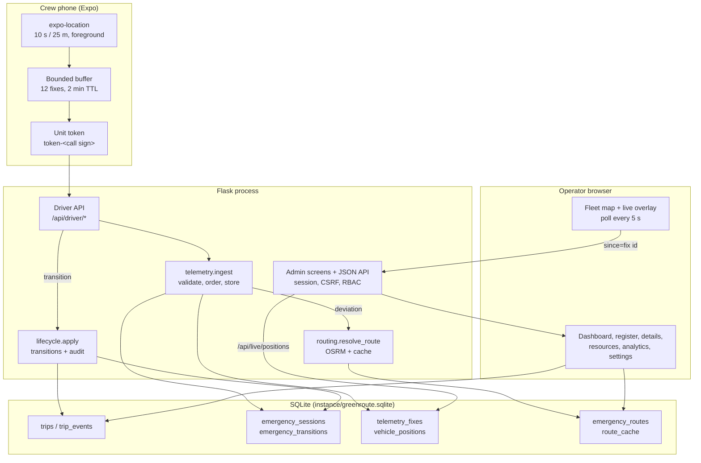

# GREEN ROUTE — system architecture

This describes the system as built today: three parts running on one development
machine, one SQLite file, one Flask process.

- The admin workspace: a server-rendered Flask application behind cookie sessions
  and role-based access control.
- The crew phone app: an Expo/React Native client that authenticates with a unit
  token and reports GPS while a response is en route.
- The routing layer: OSRM for road geometry, Nominatim and Photon for addresses,
  both called from the server and cached in SQLite.

The design notes from the original build plan (including features that are not
implemented) are kept in `docs/internal/` and are not part of the published
documentation.

---

## 1. Components

| Component | Where | Responsibilities |
|---|---|---|
| Admin web application | `app.py`, `templates/`, `static/` | Screens, admin JSON API, exports, access enforcement |
| Admin auth blueprint | `blueprints/admin_auth.py` | Sign in, sign out, session info |
| Administrator management | `blueprints/admin_users.py` | Create accounts, change role/status/password |
| Driver API | `blueprints/driver_api.py` | Unit identity, assignments, transitions, issues, backup requests, telemetry |
| Route API | `blueprints/route_api.py` | Route resolution and active-route lookup for the admin |
| Lifecycle | `lifecycle.py` | Legal state transitions, actor rules, atomic application |
| Telemetry | `telemetry.py` | GPS validation, quality, health, deviation, recalculation |
| Persistence | `db.py` | Schema, migrations, all SQL, lifecycle projection |
| Administrator accounts | `admin_store.py` | Password hashes, sessions, throttling, audit log |
| Routing adapter | `routing.py` | OSRM call, response normalisation, cache |
| Geocoding | `geocoding.py` | Nominatim and Photon with rate limiting and cache |
| Crew phone app | `../driver-app` | Response view, transitions, location sharing |
| Live overlay | `static/js/emergency-live.js` | Polls positions, draws markers, trails, warnings |

Paths in the table are relative to `backend/`, except the crew app, which is
`driver-app/` at the repository root.

There is no message broker, no background worker and no frontend build step. The
Flask process does everything synchronously in the request that triggered it.

---

## 2. Data flow

Text form, in the order a position takes:

1. The phone measures a fix and holds it in a bounded local buffer.
2. `POST /api/driver/telemetry` with the unit token and a batch of fixes.
3. The server resolves the unit from the token, the response from that unit's open
   assignment, and checks that the emergency session is ACTIVE.
4. `telemetry.ingest` validates each fix (coordinates, accuracy, clock, plausibility,
   ordering), writes it to `telemetry_fixes`, and upserts the single row in
   `vehicle_positions` under a SQL ordering guard.
5. The session's `last_seen_at` moves; telemetry health becomes LIVE/DELAYED/STALE/
   LOST from the server's receipt time.
6. If the position is more than 150 m from the stored route (and accuracy is good
   enough to say so), one route recalculation may run; the previous route row is
   marked superseded and kept.
7. The admin live overlay polls `/api/live/positions?since=<last fix id>` and draws
   markers, trails and a warning strip. Nothing is pushed; nothing reloads.

---

## 3. The emergency is a server object

`trips.status` is authoritative. `emergency_sessions.state` is a projection of it,
written in the same transaction, and exists so the lifecycle, the audit trail and
telemetry eligibility all read one vocabulary:

| Trip status | Session state |
|---|---|
| `scheduled` | `CREATED` |
| `accepted` | `VERIFIED` |
| `in_transit` | `ACTIVE` |
| `on_scene` | `ON_SCENE` |
| `completed` | `COMPLETED` |
| `cancelled` | `CANCELLED` |
| — | `EXPIRED` (watchdog ceiling only) |

Only an ACTIVE session accepts telemetry. `lifecycle.apply` is the single writer of
transitions: it checks the edge, the actor, writes the status conditionally
(`UPDATE ... WHERE status IN (...)` plus a row-count test), appends the event, the
transition row and the session projection, all in one transaction.

The one automatic closure is a twelve-hour activation ceiling
(`lifecycle.expire_overtime`). Losing GPS never closes a response — it marks the
position stale and warns operators.

---

## 4. Telemetry model

Two tables with different jobs:

- `telemetry_fixes` — append-only trail, one row per accepted fix, 14-day retention,
  pruned after every accepted batch. Its `id` is the polling event id.
- `vehicle_positions` — exactly one row per response, replaced only by a strictly
  newer fix. The dashboard's "where is everything now" never touches the trail.

Ordering is enforced in the upsert's `WHERE` clause, so a slow request that arrives
after a fast one updates no row. A retried `client_fix_id` is answered as a duplicate
rather than stored twice.

Health bands, computed on read from `received_at`:

| Status | Age | Meaning |
|---|---|---|
| LIVE | ≤ 15 s | Reporting normally |
| DELAYED | ≤ 45 s | A little old |
| STALE | ≤ 120 s | Treat as historical |
| LOST | > 120 s | Signal lost; marker stays, greyed |
| UNKNOWN | never reported | No position for this response (60 s grace after activation) |

Quality comes from reported accuracy: `good` ≤ 100 m, `poor` > 100 m (up to 1000 m
accepted). A `poor` fix can never trigger a route recalculation.

---

## 5. Transport choice

Polling. One GET per open admin tab every 5 s, cursor-based, with a full poll every
sixth tick so a newly activated response that has not reported yet still appears.

The payload is push-shaped: `{event_id, positions[]}` with `event_id` equal to the
highest fix id in the answer. A future SSE or WebSocket publisher can emit the same
object, and only the client's `poll()` changes. SSE, Socket.IO and MQTT are compared
in `docs/phase-c.md` §11 and rejected for the current deployment (one Flask process,
no sticky sessions, no broker).

---

## 6. Routing and deviation

`routing.resolve_route(origin, destination)` calls OSRM over HTTP, normalises the
result to `{provider, geometry, distance_m, duration_s}`, and caches it in
`route_cache`. Successful routes are stored per response in `emergency_routes` with a
`superseded_by` link, so the path at any past moment stays answerable.

Deviation is the shortest distance from the latest trusted position to the active
polyline, computed with a local equirectangular projection per segment. Threshold
150 m, cooldown 90 s, never from a `poor` fix. A recalculation failure marks
`trips.route_quality = 'degraded'` and leaves the previous route in place. A straight
line is never stored as a route.

OSRM's public server routes on a static road graph. Nothing here is traffic-aware,
and the interface never says otherwise.

---

## 7. Access model

Every administrative endpoint is listed with the permission it needs in
`app.ENDPOINT_PERMISSIONS`. A route registered without an entry fails the test suite,
so the surface cannot grow silently.

| Role | Permissions |
|---|---|
| SUPER_ADMIN | all 15 |
| ADMIN | 13 (no `admins.manage`, no `settings.manage`) |
| EMERGENCY_OPERATOR | 10 (dispatch, cancel, create, assign, view, route resolve) |
| VIEWER | 5 (view only) |

Sessions are server-side: the cookie carries an opaque token, only its SHA-256 is
stored, every state-changing request needs the per-session CSRF header, and expiry is
8 h absolute / 45 min idle. Sign-in is throttled per e-mail and address (5 failures
in 15 min). See `docs/security.md`.

The phone has no session: it presents `Authorization: Bearer token-<call sign>` and
is scoped to its own vehicle by the server on every request.

---

## 8. Deployment shape

Single process, single SQLite file, no containers. That is deliberate for a student
project and it bounds the architecture:

- ~100 concurrently active vehicles is the comfortable ceiling (about 1,200 writes a
  minute); 1,000 needs a database with concurrent writers.
- One Flask process means no in-memory fan-out between workers, which is another
  reason polling was chosen.
- Static files are served by Flask in development; a deployment should put a real
  WSGI server and TLS in front, and set `GREENROUTE_HTTPS=1`.

Performance estimates for 10/100/1,000/10,000 vehicles are in `docs/phase-c.md` §16.
