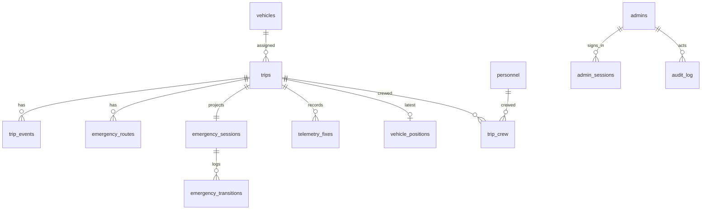

# Database

One SQLite file, `instance/greenroute.sqlite` by default (`GREENROUTE_DB` overrides
it). Access goes through `db.py`; there is no ORM and no query builder. Every
statement uses bound parameters.

`db.init_db()` is the schema and the migration: it creates missing tables, adds
missing columns behind `PRAGMA table_info` checks, backfills the emergency session
projection, and runs on every application start. It is safe to run repeatedly, which
is why there is no separate migration command.

---

## 1. Tables

### Operational records

| Table | Purpose | Key columns |
|---|---|---|
| `trips` | One emergency response | `reference`, `status`, `priority`, endpoints and coordinates, `vehicle_id`, stored route (`route_json`, `route_provider`, `route_computed_at`, `route_distance_m`), route health (`route_quality`, `route_deviation_m`, `route_recalculated_at`) |
| `trip_events` | Human-readable history per response | `trip_id`, `kind`, `message`, `created_at` |
| `vehicles` | Fleet registry | `call_sign` (unique in practice; the unit token is derived from it), `vehicle_type`, `status` |
| `personnel` | Crew registry | `employee_id`, `name`, `role`, `status` |
| `trip_crew` | Crew assigned to a response | `(trip_id, personnel_id)`, `role_on_response` |
| `settings` | Workspace preferences | `key`, `value` |

### Emergency lifecycle

| Table | Purpose | Key columns |
|---|---|---|
| `emergency_sessions` | One row per response, the lifecycle projection | `trip_id`, `state`, `activated_at`, `verified_at`, `closed_at`, `close_reason`, `expires_at`, `last_seen_at` |
| `emergency_transitions` | Append-only transition log | `session_id`, `action`, `from_state`, `to_state`, `actor_kind`, `actor_id`, `actor_role`, `reason` |
| `emergency_routes` | Route history per response | `provider`, `geometry_json`, `distance_m`, `duration_s`, `reason`, `computed_at`, `superseded_by` |

`trips.status` is authoritative. `emergency_sessions.state` is written in the same
transaction and never independently.

### Telemetry

| Table | Purpose | Key columns |
|---|---|---|
| `telemetry_fixes` | Append-only GPS trail, 14-day retention | `trip_id`, `session_id`, `vehicle_id`, `client_fix_id` (unique), `sequence`, `lat`, `lng`, `accuracy_m`, `heading_deg`, `speed_mps`, `device_time`, `received_at`, `quality`, `source` |
| `vehicle_positions` | Latest trusted position, one row per response | `trip_id` (primary key), `last_fix_id`, coordinates, `device_time`, `received_at`, `sequence`, `quality`, `source`, `updated_at` |

`telemetry_fixes.id` is also the polling event id for `/api/live/positions?since=`.

### Administration

| Table | Purpose | Key columns |
|---|---|---|
| `admins` | Administrator accounts | `email`, `password_hash` (scrypt), `role`, `status`, `last_login_at` |
| `admin_sessions` | Server-side sessions | `admin_id`, `token_hash` (SHA-256 of the cookie value), `csrf_token`, `expires_at`, `last_seen_at`, `revoked_at` |
| `admin_login_attempts` | Throttling | `email`, `ip`, `outcome`, `attempted_at` |
| `audit_log` | Append-only audit trail | `at`, `actor_id`, `actor_role`, `action`, `outcome`, `trip_id`, `session_id`, `ip`, `detail_json` |

`audit_log` refuses `UPDATE` and `DELETE` through database triggers.

### Caches and idempotency

| Table | Purpose |
|---|---|
| `route_cache` | Provider answers keyed by rounded endpoints, so two screens asking for the same pair spend one call |
| `geocode_cache` | Address lookups with status, coordinates and provider reference |
| `client_events` | Driver transition idempotency: `client_event_id` → applied action and status |

---

## 2. Relationships



Foreign keys are declared with `ON DELETE CASCADE` where a child cannot outlive its
response (events, routes, fixes, position, crew). `emergency_sessions.session_id`
references on telemetry are `ON DELETE SET NULL` so a fix survives a session row
being replaced.

---

## 3. Indexes

| Index | Table | Columns |
|---|---|---|
| `idx_trips_status` | `trips` | `status` |
| `idx_trips_created` | `trips` | `created_at` |
| `idx_trips_vehicle` | `trips` | `vehicle_id` |
| `idx_events_trip` | `trip_events` | `trip_id` |
| `idx_routes_trip` | `emergency_routes` | `trip_id` |
| `idx_sessions_state` | `emergency_sessions` | `state` |
| `idx_transitions_session` | `emergency_transitions` | `session_id` |
| `idx_fixes_trip` | `telemetry_fixes` | `(trip_id, id)` |
| `idx_fixes_received` | `telemetry_fixes` | `received_at` |
| `idx_positions_updated` | `vehicle_positions` | `updated_at` |
| `idx_audit_at`, `idx_audit_trip` | `audit_log` | `at`, `trip_id` |
| `idx_admin_sessions_admin` | `admin_sessions` | `admin_id` |
| `idx_login_attempts` | `admin_login_attempts` | `(email, attempted_at)` |
| `idx_trip_crew_personnel` | `trip_crew` | `personnel_id` |

---

## 4. Ordering and concurrency

Two rules are enforced in SQL rather than in Python, because Python cannot make them
atomic:

**Status transitions.** `db.update_status` runs
`UPDATE trips SET status = ? WHERE id = ? AND status IN (...)` and checks
`rowcount`. Two operators cannot both win; the loser gets a conflict, not a silent
overwrite.

**Latest position.** `db.upsert_latest_position` is an `INSERT ... ON CONFLICT
(trip_id) DO UPDATE` whose `WHERE` clause requires the incoming fix to be strictly
newer by `device_time`, with `sequence` as the tie-break. A slow request that arrives
after a fast one updates no row.

SQLite runs in its default rollback journal with one writer at a time. That is the
main scaling limit; see `docs/known-limitations.md`.

---

## 5. Retention

| Data | Kept | Mechanism |
|---|---|---|
| `trips`, `trip_events`, `emergency_routes`, `emergency_transitions`, `audit_log` | indefinitely | operational and audit record |
| `telemetry_fixes` | 14 days (`GREENROUTE_TELEMETRY_RETENTION_DAYS`) | pruned after every accepted batch |
| `vehicle_positions` | one row per response | removed with the response |
| `route_cache`, `geocode_cache` | until replaced | keyed caches, no TTL sweep |
| `admin_sessions` | until expiry or revocation | expired rows are ignored, not swept |

---

## 6. Working with the database

```bash
# Inspect
sqlite3 instance/greenroute.sqlite ".tables"
sqlite3 instance/greenroute.sqlite "SELECT reference, status FROM trips ORDER BY id DESC LIMIT 5;"

# Back up before a schema change (the app also does this by hand before migrations)
cp instance/greenroute.sqlite instance/backup-$(date +%Y%m%dT%H%M%S).sqlite

# Start over, keeping the old file
mv instance/greenroute.sqlite instance/greenroute.old.sqlite
python app.py     # recreates the schema and a bootstrap administrator
```

`instance/` is gitignored. Never commit a database file: it contains administrator
password hashes, session tokens, audit history and vehicle positions.
